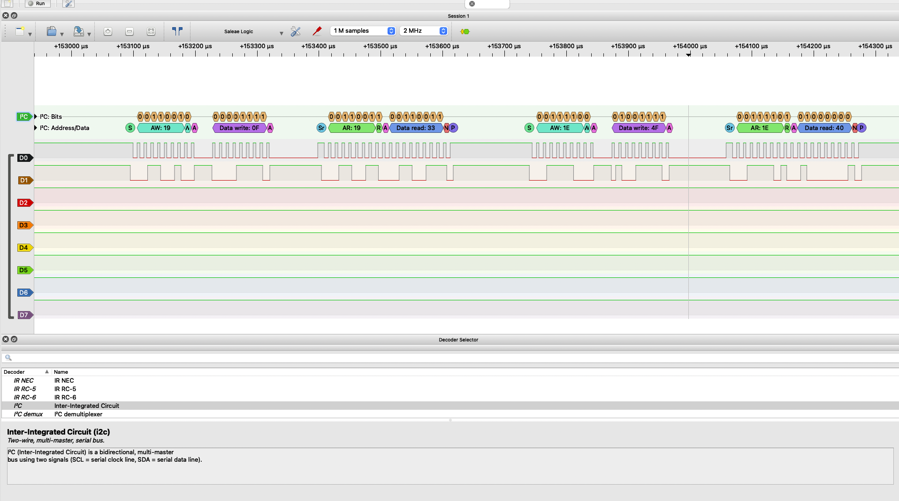

# EE186 Lab 3: I2C You!

Artash Nath

Board: NUCLEO-L4R5ZI-P. Sensor: Adafruit LSM303AGR breakout (I2C1 on PB8 = SCL / PB9 = SDA, VIN on 3.3 V).

## part 3 - getting ready (datasheet)

1. I2C addresses of the accelerometer and magnetometer (r/w bit as b):

   LSM accel sensor has two I2C slaves, one for the accelerometer (0x19 = 0011001) and one for the compass (0x1E = 0011110) both are printed on the back of the sensor

2. What is the sub-address (SUB), and how does it differ from the I2C address?

   The I2C address selects which chip on the bus the mcu is talking to, and the sub-address selects which register in that chip, like the LSM sensor has 2 sub addresses for each axis stored as 2 registers.

3. CTRL1 register address and the value written to it to enable acceleration measurement (data rate + enable bits). Show the bit breakdown.

   When the LSM accel boots up it is in power down mode so it does not transmit data until we write to CTRL_REG1_A at 0x20. Each bit in 0x20 represents a different editable preference in the datasheet, the top 4 representing different data rates, the bottom 3 representing turning on and off individual axis, and one representing low power mode. I wrote 0101 0111 (0x57) to the register which kept all axes on, kept low power mode off, and used the 100hz rate selection.

4. 8-bit sub-addresses used to request X, Y, Z acceleration data:

   Each axis' data is represented in 16-bits, low half in one register high half in the second one. X-axis is 0x28 and 0x29, Y is 0x2A and 0x2B, and Z is 0x2C and 0x2D. To get the full raw values my code combines the upper and lower half bytes.

## part 4 - driver (WHO_AM_I)

logic analyzer screenshot: [part4-driver/whoami.png](part4-driver/whoami.png) . code is [part4-driver/main.c](part4-driver/main.c)

## part 5 - measuring gravity

video: [part5-gravity/gravity.MOV](part5-gravity/gravity.MOV) . code is [part5-gravity/main.c](part5-gravity/main.c) (six single-byte reads) and [part5-gravity/main_multibyte.c](part5-gravity/main_multibyte.c) (one six-byte read)

Multi-byte read: how the HAL_I2C_Mem_Read() arguments change to read all three axes in one transaction, and why (datasheet section):

   Instead of reading from 0x28 we read from 0x28 OR masked with 0x80 to turn on the 7th bit to 1 as the datasheet (6.1.1) says the bit must be 1 for the sensor to automatically increment the address in a multi-byte read, instead of just returning the same values 6 times
